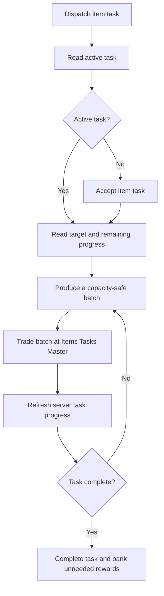
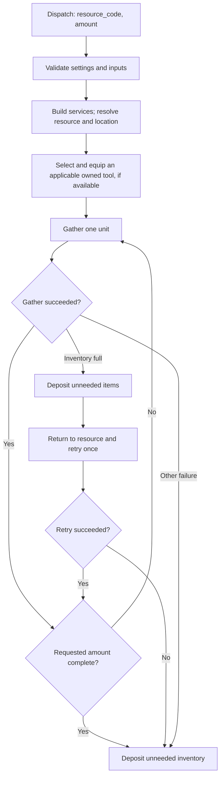
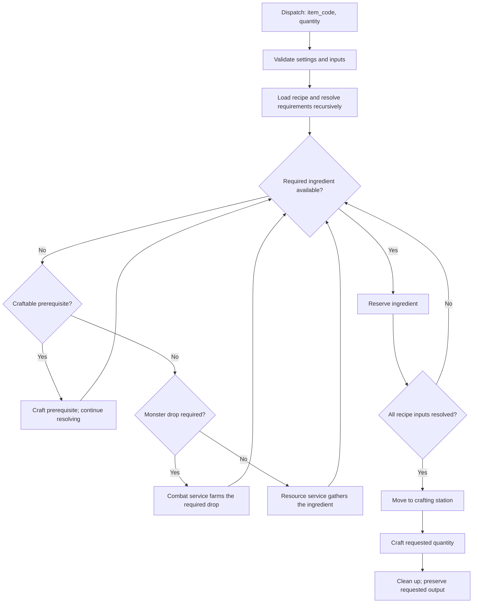
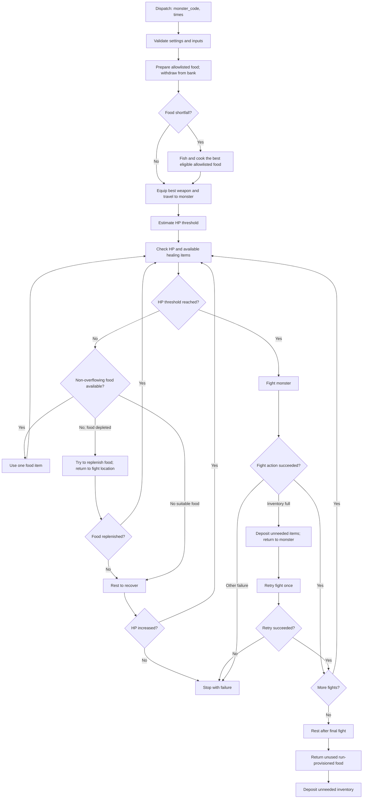
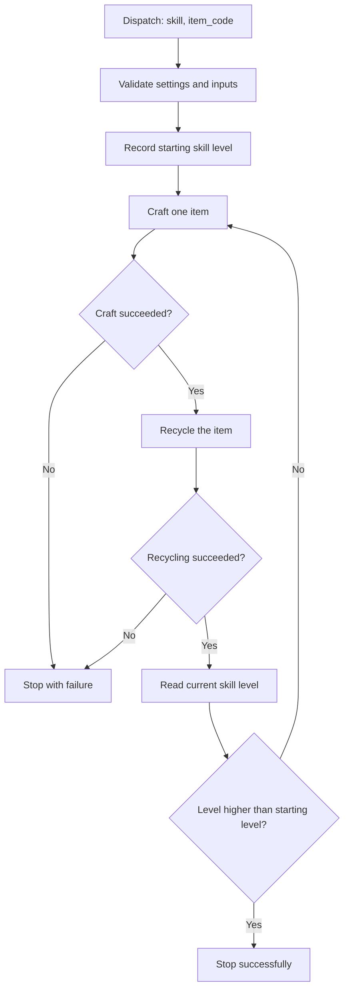

# Artifacts MMO Automation

Python automation for gathering resources, crafting items, fighting monsters,
leveling crafting skills, and completing item tasks in Artifacts MMO.

## Project structure

```text
├── .github/workflows/
│   ├── craft_items.yml
│   ├── fight_monsters.yml
│   ├── gather_resources.yml
│   ├── level_crafting_skills.yml
│   ├── complete_item_task.yml
│   └── tests.yml
├── scripts/
│   ├── bootstrap.py              # Shared construction of the service graph
│   └── <automation entry points>
├── src/
│   ├── client/                   # HTTP transport and API errors
│   ├── config/                   # Runtime settings
│   ├── domain/                   # Game data and pure calculations
│   └── services/
│       ├── combat/               # Fight, equipment, food, and recovery
│       ├── inventory/            # Bank operations and inventory cleanup
│       ├── items/                # Item lookup and recycling
│       ├── character_service.py
│       ├── crafting_service.py
│       ├── movement_service.py
│       ├── resource_service.py
│       └── task_service.py
└── tests/                        # Mirrors scripts/ and src/
```

Each script is a thin entry point: it validates its inputs, creates the API
client, builds shared services through `scripts/bootstrap.py`, and delegates
the game actions to those services.

## Services

| Area | Responsibility |
| --- | --- |
| `client/` | Sends authenticated API requests and handles retries and API errors. |
| `config/` | Loads and validates runtime settings, including API credentials and combat-food options. |
| `domain/` | Holds local game reference data and calculations that do not perform API actions. |
| `CharacterService` | Reads character state, inventory, and skills; equips and uses items. |
| `MovementService` | Moves the character to resource, monster, bank, and crafting locations. |
| `ResourceService` | Resolves gathering requirements, selects an available gathering tool, gathers resources, retries after a full inventory, and can stop a task batch at capacity. |
| `CraftingService` | Resolves recipe requirements recursively, obtains missing resources or monster drops, travels to a crafting station, crafts, and cleans up inventory. |
| `combat/CombatService` | Coordinates combat runs and monster-drop farming. `FightService` performs individual fights; `CombatEquipmentService` selects a weapon; `CombatRecoveryService` manages HP recovery; `CombatFoodService` provisions, replenishes, and returns food. |
| `inventory/BankService` | Deposits and withdraws items through the bank. |
| `inventory/InventoryCleanupService` | Deposits unneeded items while preserving reserved quantities, equipped items, weapons, and gathering tools. |
| `items/ItemCatalogService` | Retrieves item metadata used by gathering, crafting, combat, and cleanup. |
| `items/RecyclingService` | Recycles crafted items for crafting-skill experience. |
| `TaskService` | Accepts or resumes an item task, produces its target in inventory-safe batches, trades batches at the Items Tasks Master, and cleans up rewards. |

Gathering and combat attempt to free inventory space and retry once when an
action fails because the inventory is full. End-of-run cleanup deposits
unneeded items; crafting preserves the requested output and ingredients still
needed for the recipe.

## Automation workflows

All five game workflows are manually dispatched through GitHub Actions. They
use the `ARTIFACTS_API_KEY` repository secret and pass their inputs to the
corresponding script.

| Workflow | Inputs | Script |
| --- | --- | --- |
| Gather Resources | `resource_code`, `amount` (default `1`) | `scripts/gather_resources.py` |
| Craft Items | `item_code`, `quantity` (default `1`) | `scripts/craft_items.py` |
| Fight Monsters | `monster_code`, `times` (default `1`) | `scripts/fight_monsters.py` |
| Level crafting skills | `skill`, `item_code` | `scripts/level_crafting_skills.py` |
| Complete Item Task | None; resumes an active item task or accepts one | `scripts/complete_item_task.py` |

### Complete an item task

The workflow starts at the hardcoded Items Tasks Master location, resumes an
active item task or accepts one when no task is active, and produces its target
in inventory-safe batches. Raw resources are gathered until inventory capacity
is reached; craftable tasks estimate their base ingredients to choose a
capacity-safe batch. After each batch, it trades the deliverable and refreshes
server task progress. On completion, normal cleanup banks unneeded reward
items such as task coins. Gold remains character currency. It assumes the
target item is not already in inventory or the bank and that the inventory has
no unnecessary items when the workflow starts.



### Gather resources

The resource service finds the resource location and gathering subtype, equips
the strongest applicable owned tool from the local tool catalogue when
available, then gathers the requested amount. If an action encounters a full
inventory, it deposits unneeded items, returns to the resource, and retries
that action once. Final cleanup deposits unneeded inventory.



### Craft items

The crafting service checks the recipe and recursively resolves its
requirements. It uses available inventory first; missing ingredients are
gathered, crafted as prerequisites, or farmed from a monster as appropriate.
After crafting at the required station, cleanup keeps the requested output and
deposits incidental drops and leftover materials. Ingredients are protected
while they are still needed by later recipe steps.



### Fight monsters

Before fighting, combat provisions allowlisted healing food from the bank and
tries to fish and cook an eligible allowlisted meal to cover a shortfall. It
then equips its best available weapon, travels to the monster, and estimates a
safe HP threshold. Before each fight, recovery uses healing items only when
they will not exceed maximum HP, and rests when needed. When no healing food
remains during recovery, combat attempts to replenish it and return to the
current fight location; resting remains the fallback if more food cannot be
obtained. At the end, it rests, returns unused run-provisioned food, and cleans
up unneeded inventory.



Combat food is restricted to `COMBAT_FOOD_ALLOWLIST`; `COMBAT_FOOD_COUNT`
controls the target provision and can be set to `0` to disable provisioning.
If food cannot be obtained, recovery can still use resting.

### Level crafting skills

This workflow records the starting level of the selected crafting skill, then
repeats a single-item craft and recycle cycle until the skill level increases.
Crafting or recycling failure stops the run.


